# decoration-studio 操作手册

> **装修设计工作台** —— 2D 平面编辑 / 3D 场景 / 多方案管理 / 算量与导出。
>
> 本文件是**面向使用者**的操作手册：怎么用、怎么操作、快捷键是什么。
> 想了解工程结构、契约与实现细节，请看文末「开发者文档」。
>
> 技术栈：Vue 3 + Vite + TypeScript · 许可证 MIT · 开源仓库
> <https://github.com/jun838480981/decoration-studio>

---

## 目录

- [1. 快速上手](#1-快速上手)
- [2. 界面布局](#2-界面布局)
- [3. 2D 平面编辑](#3-2d-平面编辑)
- [4. 3D 场景](#4-3d-场景)
- [5. 家具布置](#5-家具布置)
- [6. 户型管理](#6-户型管理)
- [7. 结构与拆改](#7-结构与拆改)
- [8. 报价与算量](#8-报价与算量)
- [9. 校验与对比](#9-校验与对比)
- [10. 导出](#10-导出)
- [11. 主题与显示](#11-主题与显示)
- [12. 快捷键总表](#12-快捷键总表)
- [13. 触屏操作](#13-触屏操作)
- [14. 数据与存储](#14-数据与存储)
- [15. 常见问题](#15-常见问题)
- [16. 开发者文档](#16-开发者文档)

> 本手册所有截图均为**真实界面实拍**（非示意图），采集自生产构建产物。
> 截图脚本见 `.tools/capture-manual-shots.cjs`，可随时重新生成。

---

## 1. 快速上手

### 1.1 运行

```bash
pnpm install     # 首次：安装依赖
pnpm dev         # 开发模式 → http://localhost:5173
```

或使用构建产物（可部署到任意静态服务器）：

```bash
pnpm build       # 产物在 dist/
pnpm preview     # 本地预览 → http://localhost:4173
```

> 产物使用相对路径（`base: './'`），可直接放在任意子目录下打开。

### 1.2 五分钟上手

1. 打开页面 → 默认载入「三室两厅两卫」示例户型，2D 平面图已渲染
2. 左侧**家具库**点选或拖拽家具到平面图上 → 摆好家具
3. 按 `T`（或点顶部「3D 场景」）→ 看三维效果
4. 右侧**属性面板**显示房间面积、地面材料结算、方案统计
5. 顶部「导出」→ 选格式导出图纸或报价单

---

## 2. 界面布局

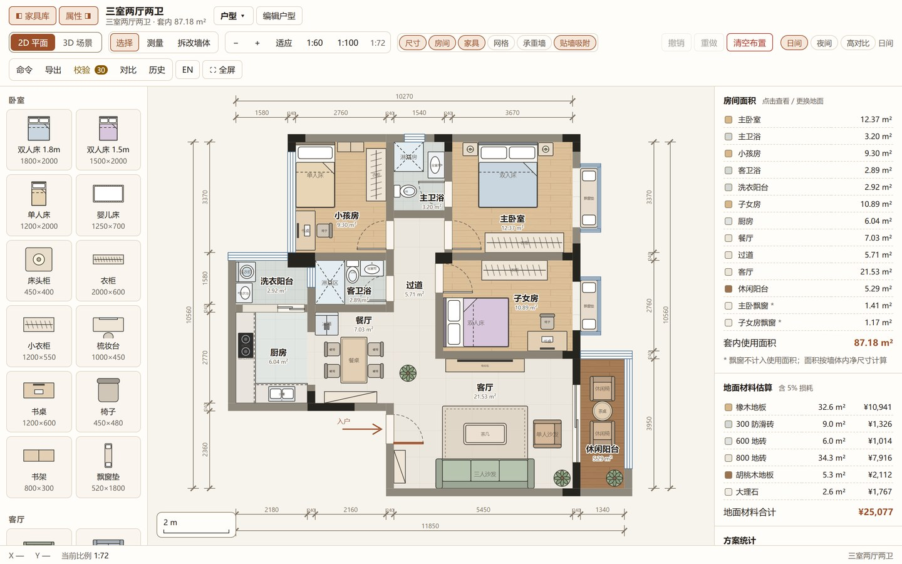

```
┌─────────────────────────────────────────────────────────────┐
│ 顶栏：家具库 | 属性 | 户型 | 编辑户型 | 2D/3D | 工具 | 缩放  │
│       图层 | 撤销重做 | 主题 | 命令 导出 校验 对比 历史 | EN  │
├──────────┬──────────────────────────────┬───────────────────┤
│ 家具库    │                              │ 属性面板           │
│（可收起） │        画布（2D / 3D）        │（可收起）          │
│          │                              │ · 房间面积         │
│ 6 分类    │  2D：SVG 平面图               │ · 地面材料结算     │
│ 60 条目   │  3D：WebGL 场景               │ · 方案统计         │
│          │                              │ · 选中对象属性     │
├──────────┴──────────────────────────────┴───────────────────┤
│ 底栏：鼠标 X/Y 坐标 · 当前比例 · 悬停房间 · 操作提示           │
└─────────────────────────────────────────────────────────────┘
```

上图中：左侧是 6 分类家具库，中间是 SVG 平面图（含尺寸标注链），右侧是房间面积、地面材料结算、方案统计三个面板。

**侧栏收起**：

- 顶栏「◧ 家具库」「属性 ◨」按钮，或按 `[` / `]`
- 窄屏（< 1100px）自动变为抽屉，从边缘滑出

---

## 3. 2D 平面编辑

### 3.1 三种工具

| 工具 | 快捷键 | 用途 |
| --- | --- | --- |
| **选择** | `V` | 选中 / 拖动家具、选中房间、拖拽手柄缩放旋转 |
| **测量** | `M` | 在图上拉出测量线，显示距离；`Shift` 锁定水平/垂直 |
| **拆改墙体** | `X` | 点击墙体标记拆除 / 恢复（承重墙与外墙会拒绝） |

### 3.2 视图操作

| 操作 | 方式 |
| --- | --- |
| 平移 | 空白处按住拖动；或滚轮 |
| 缩放 | 滚轮 / `+` `-` / 顶栏 `−` `＋` |
| 适应窗口 | `F` 或点「适应」 |
| 固定比例 | 点「1:60」「1:100」（对应原图纸比例） |

底栏实时显示**当前比例**（如 `1:62`）与鼠标所在的**户型坐标**（mm）。

### 3.3 图层开关

顶栏「图层」组，可独立开关 6 个图层：

| 图层 | 默认 | 说明 |
| --- | --- | --- |
| **尺寸** | 开 | 墙体尺寸标注链 |
| **房间** | 开 | 房间名称 + 面积标签 |
| **家具** | 开 | 家具图例 |
| **网格** | 关 | 参考网格线 |
| **承重墙** | 关 | 高亮承重墙（黑色） |
| **贴墙吸附** | 开 | 拖动家具时自动贴墙对齐 |

### 3.4 选中与微调

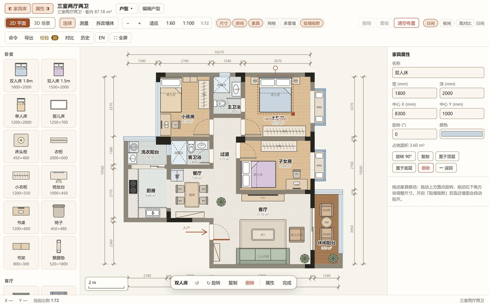

- 点选家具 → 出现选中框与 4 个手柄
- **拖动**移动；**拖角手柄**缩放；**拖旋转手柄**旋转
- 选中后用**方向键微调**：默认 10mm，按住 `Shift` 为 100mm
- `R` 旋转 90°（`Shift+R` 反向）
- `Delete` / `Backspace` 删除

### 3.5 测量与拆改

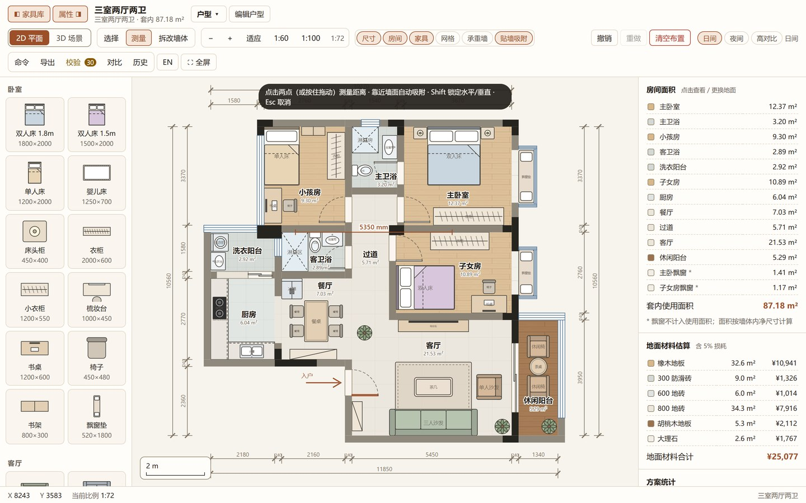

按 `M` 进入测量工具，在图上拖动即可拉出测量线，实时显示距离（按住 `Shift` 锁定水平/垂直）。

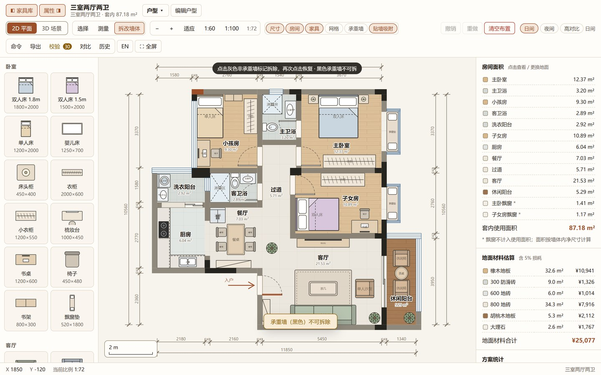

按 `X` 进入拆改工具，点击墙体标记拆除。承重墙与外墙会被拒绝并给出提示（见底栏）。

### 3.6 撤销与重做

- `Ctrl/⌘ + Z` 撤销，`Ctrl/⌘ + Shift + Z` 或 `Ctrl/⌘ + Y` 重做
- 顶栏「撤销 / 重做」按钮同效
- **双栈隔离**：家具布置（150 步）与户型结构（80 步）是两套独立的撤销栈，互不干扰
- 点「历史」可查看可视化历史时间线并跳转

---

## 4. 3D 场景

### 4.1 进入与退出

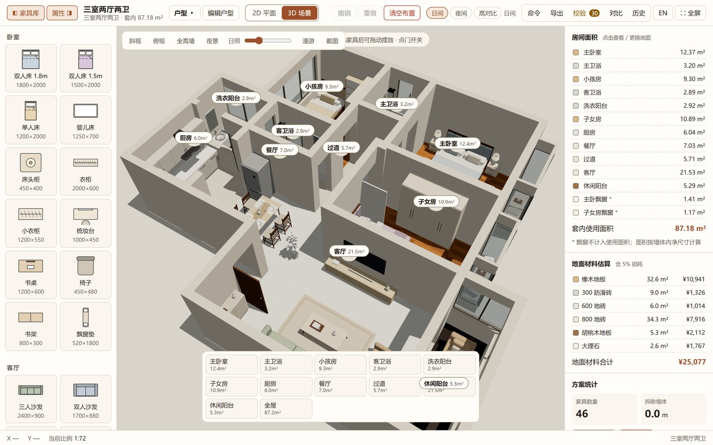

- 按 `T` 或点顶栏「3D 场景」/「2D 平面」切换
- 切换有过渡动画：墙从地面「长出来」、相机从平面视角推入斜视
- 上图是默认的斜视（鸟瞰）视角，可见墙体、家具、门窗与房间标签

### 4.2 两种相机模式

| 模式 | 说明 |
| --- | --- |
| **鸟瞰**（默认） | 鼠标拖动旋转，滚轮缩放，右键拖动平移 |
| **漫游** | 第一人称走进房子；桌面端锁定鼠标，触屏端用左下摇杆 |

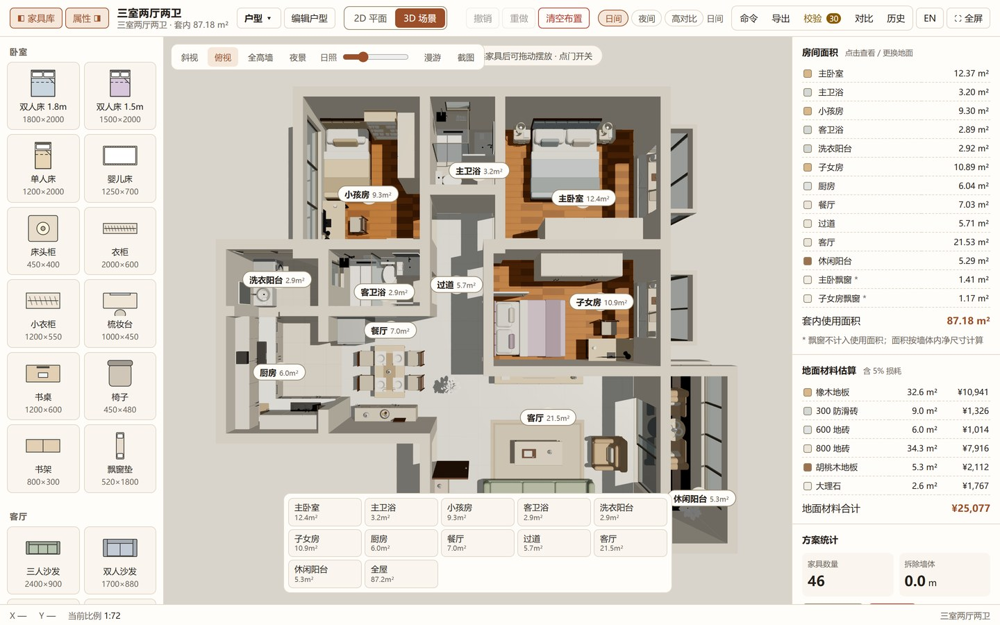

点「俯视」可切到正上方视角，适合检查家具布局与房间划分。

### 4.3 漫游操作

| 操作 | 桌面 | 触屏 |
| --- | --- | --- |
| 移动 | `W` `A` `S` `D` 或方向键 | 左下**摇杆** |
| 转向 | 移动鼠标 | 在画面上拖动 |
| 快走 | 按住 `Shift` | 摇杆推到底 |
| 开关门 | `E`（对准门）或点击门 | 点击门 |
| 退出漫游 | `Esc` | 点「退出漫游」 |

### 4.4 显示控制


点「剖切墙」切掉墙的上半部分，便于从斜上方看清所有房间的布局与家具。

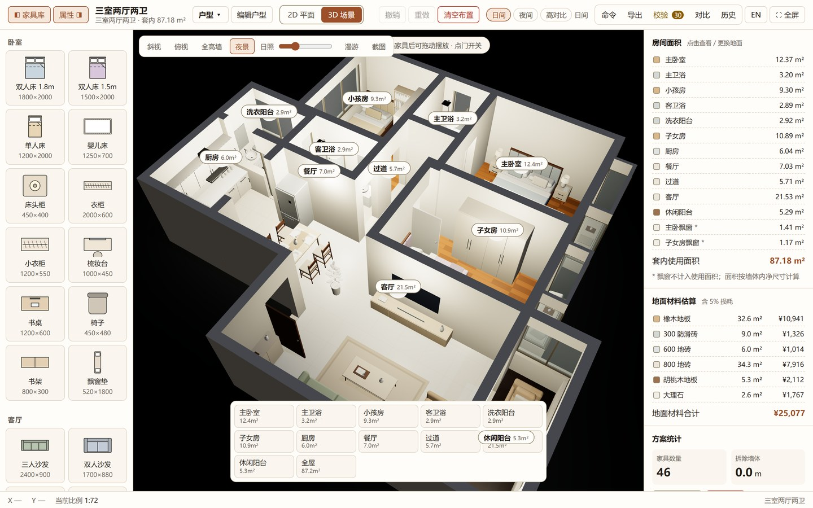

点「夜景」切换到夜间光照；配合「日照」滑杆可观察不同时段的采光效果。

| 控件 | 作用 |
| --- | --- |
| **斜视 / 俯视** | 切换相机预设角度 |
| **全高墙 / 剖切墙** | 剖切模式切掉墙的上半部分，方便看清布局 |
| **日照滑杆** | 拖动改变日照时间（7:00–18:00），观察采光 |
| **夜景** | 切换到夜间光照 |
| **家具** | 显示/隐藏 3D 家具 |
| **房间名** | 显示/隐藏 3D 房间标签 |
| **房间列表** | 左侧列表点击可「飞到」指定房间 |

### 4.5 3D 内交互

- **点击家具** → 选中，可拖动摆放（松手才记入撤销栈）
- **点击门** → 开 / 关
- **截图** → 导出当前 3D 视角为 PNG

---

## 5. 家具布置

### 5.1 家具库

左侧 6 分类共 **60 条目 / 45 种类型**：

| 分类 | 条目数 | 示例 |
| --- | --- | --- |
| 卧室 | 12 | 双人床、单人床、衣柜、床头柜、书桌、飘窗垫 |
| 客厅 | 14 | 三人沙发、转角沙发、茶几、电视柜、地毯、绿植 |
| 餐厨 | 11 | 餐桌、餐椅、岛台、橱柜台面、灶台、冰箱 |
| 卫浴 | 8 | 马桶、浴室柜、淋浴房、浴缸、洗衣机 |
| 家电 | 9 | 电视、空调、洗碗机、烘干机、空气净化器 |
| 书房 · 休闲 | 6 | 长书桌、办公椅、书架、钢琴、跑步机 |

### 5.2 添加家具

**拖拽**：从家具库按住拖到平面图目标位置松开

- 拖动时显示半透明预览，跟随光标
- 松手时按当前位置落位（带网格吸附）

**轻点**：直接点家具条目

- 若已选中房间 → 放到该房间中心
- 否则 → 放到当前画面中心

> 窄屏下拖出抽屉后会自动收起。

### 5.3 调整家具

选中后：

- **拖动**移动（开启「贴墙吸附」时会自动贴到墙边）
- **拖角手柄**缩放（宽 / 深）
- **拖旋转手柄**旋转（`Shift` 锁定 15° 步进）
- 属性面板可精确输入：名称、宽、深、中心 X/Y、旋转角度、颜色
- 按钮：旋转 90°、复制、置顶、置底、删除

### 5.4 自动布置

内置户型自带手工精排的家具（46 件）。若需要重新生成：

- **一键自动布置**：进入结构编辑（`E`）后，右侧属性面板底部有「一键自动布置」按钮，
  会按当前户型自动摆放家具
- 或切到其它户型再切回来 → 恢复该户型的默认布置
- 「清空布置」会移除所有家具（可撤销）

---

## 6. 户型管理

### 6.1 户型库

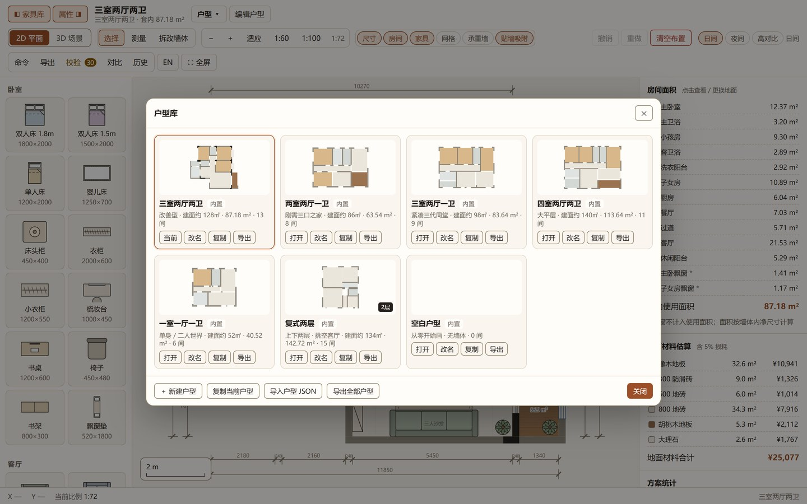

按 `P` 或点顶栏「户型 ▾」打开。内置 **7 个户型**：

| 户型 | 说明 |
| --- | --- |
| 三室两厅两卫 | 默认，87.18 m² |
| 两室两厅一卫 | 紧凑两居 |
| 三室两厅一卫 | 单卫三居 |
| 四室两厅两卫 | 大四居 |
| 一室一厅一卫 | 小户型 |
| 复式两层 | 多层（一层 64.96 m² / 二层 77.76 m²） |
| 空白户型 | 从零开始 |

**操作**：打开、改名、复制、导出、删除（内置户型不可删）

### 6.2 楼层切换（复式户型）

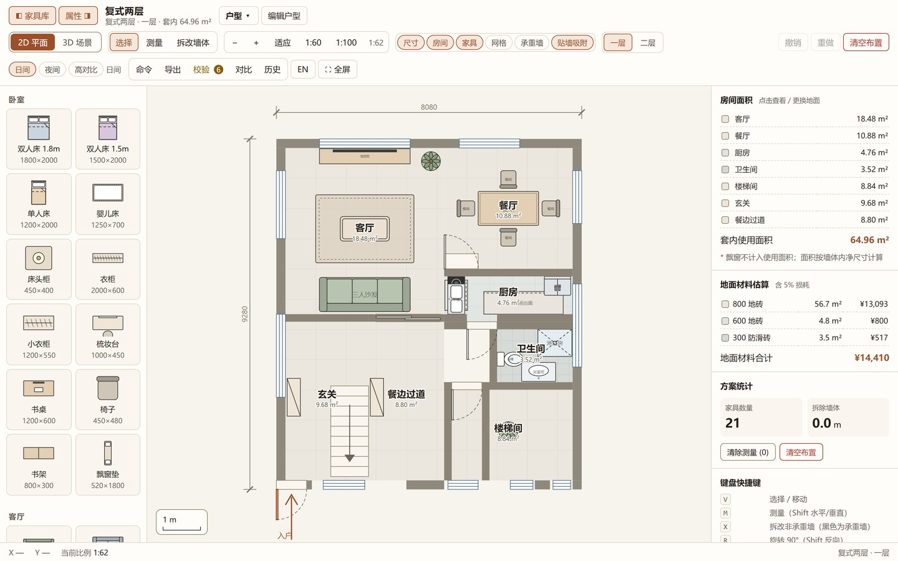

- 按 `1` / `2` 切换楼层，或点顶栏的楼层条（上图中「一层 / 二层」按钮）
- 单层户型不显示楼层条
- 每层有独立的家具布置与撤销栈

### 6.3 结构编辑

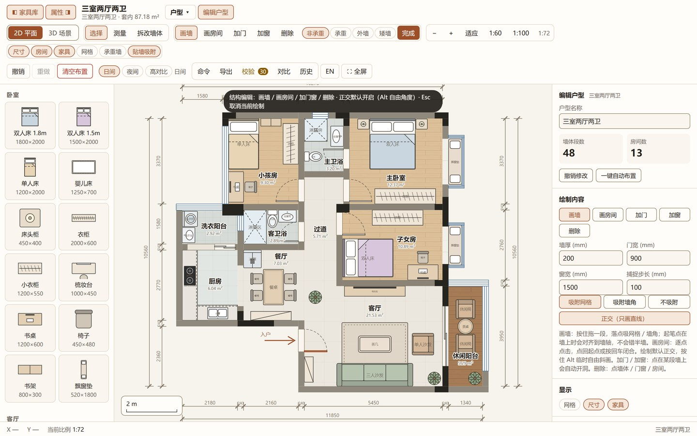

按 `E` 或点「编辑户型」进入结构编辑模式：

- 可绘制新墙体、房间、门、窗
- 墙体类型可选：**非承重 / 承重 / 外墙 / 矮墙**
- 绘制房间时按 `Enter` 闭合多边形
- 右侧面板底部有「一键自动布置」，可按当前户型自动摆放家具
- 按 `E` 或点「完成」退出

---

## 7. 结构与拆改

### 7.1 拆改墙体

按 `X` 进入拆改工具，点击墙体：

| 墙体类型 | 颜色 | 可否拆除 |
| --- | --- | --- |
| 承重墙 | 深色 | ❌ 拒绝（提示「承重墙不可拆除」） |
| 外墙 | 中色 | ❌ 拒绝（提示「外墙属于建筑外围护结构」） |
| 非承重墙 | 浅色 | ✅ 可拆 |
| 矮墙 | 描边 | ✅ 可拆 |

再点一次可**恢复**。拆除长度会计入报价的「拆除墙体长度」。

### 7.2 房间属性


点击房间 → 右侧面板显示：

- 房间名称（可改）
- 房间面积（自动计算，鞋带公式）
- **地面材质**（8 种可选，切换后 2D 图案与 3D 材质同步变化）

---

## 8. 报价与算量

右侧属性面板常驻显示：

### 8.1 房间面积

列出所有房间的名称与面积，点击可定位到该房间。

- **套内使用面积**：排除飘窗（飘窗不计入）
- 面积按墙体内净尺寸计算

### 8.2 地面材料结算

| 材料 | 单价（元/m²） | 默认用于 |
| --- | --- | --- |
| 橡木地板 | 320 | 卧室、书房 |
| 胡桃木地板 | 380 | 休闲阳台 |
| 800 地砖 | 220 | 客厅、餐厅、过道 |
| 600 地砖 | 160 | 厨房 |
| 大理石 | 650 | 飘窗 |
| 300 防滑砖 | 140 | 卫生间、洗衣阳台 |
| 水磨石 | 280 | — |
| 满铺地毯 | 200 | — |

计算口径：`面积 × 单价 × 1.05`（含 5% 损耗）。

### 8.3 方案统计

- 家具数量
- 拆除墙体长度

### 8.4 完整报价单

点顶栏「导出」→ CSV / XLSX，或点「打印」生成可另存为 PDF 的图册。报价单包含：

封面 → 套内面积 → 墙面面积 → 拆除长度 → 房间数 → 家具数 → 材料明细表 → 合计

---

## 9. 校验与对比

### 9.1 平面图校验

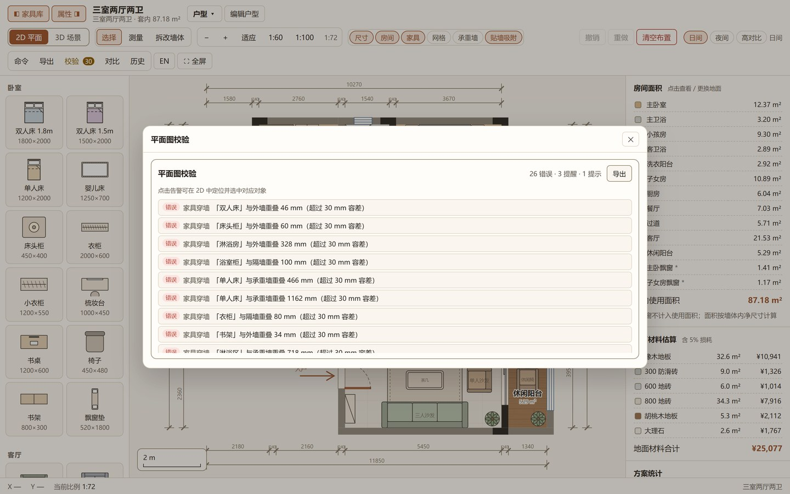

点顶栏「**校验**」（按钮上会显示实时告警数，如「校验 30」）。

自动检查以下问题：

- 家具穿墙
- 家具压住门洞
- 遮挡主要通道
- 房间内无家具
- 房间尺寸异常

上图中列出了具体告警（如「家具穿墙『双人床』与外墙重叠 46mm（超过 30mm 容差）」），
面板顶部汇总「26 错误 · 3 提示 · 1 提示」。

**点击任一告警** → 视图自动定位到该位置，并选中对应对象。

### 9.2 方案对比

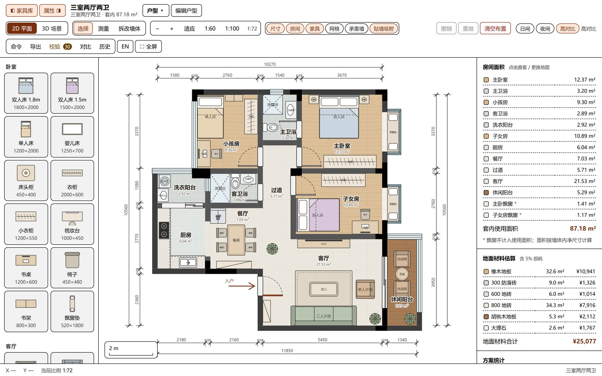

点顶栏「**对比**」，勾选 2 个以上方案，并排比较：

- 面积差异
- 材料用量差异
- 家具数量差异
- 差异摘要（以第一个为基准）

### 9.3 历史面板

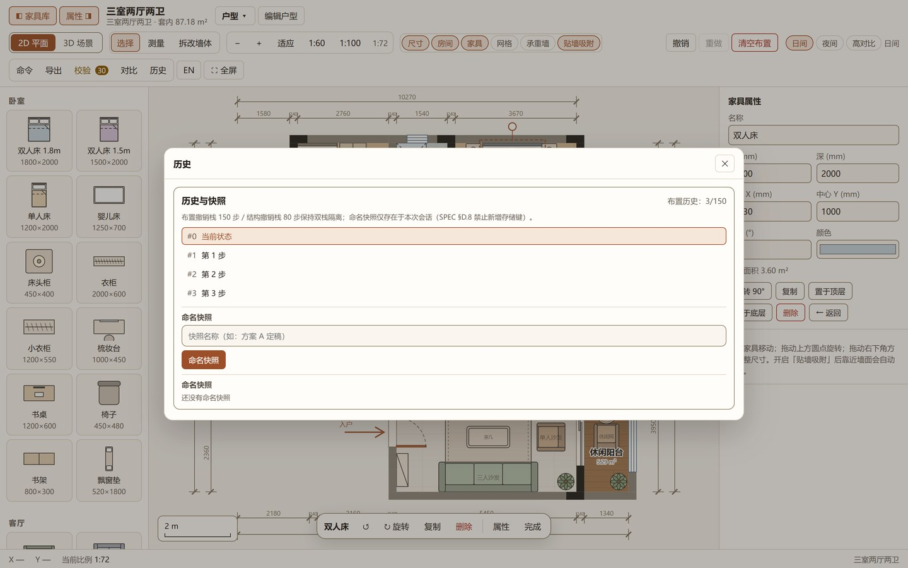

点顶栏「**历史**」查看撤销时间线，可跳到任意历史点。

> 命名快照仅存于当前会话内存，刷新后丢失（不占用存储配额）。

---

## 10. 导出

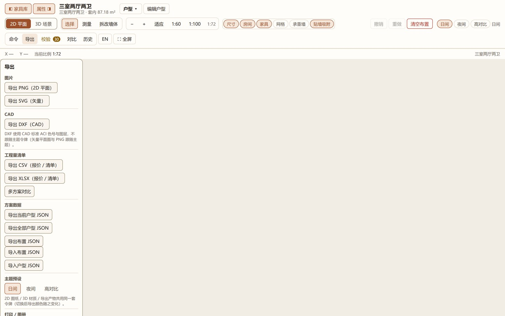

点顶栏「**导出**」：

| 格式 | 内容 | 说明 |
| --- | --- | --- |
| **PNG** | 2D 平面图 | 高分辨率位图 |
| **SVG** | 2D 平面图 | 矢量，可无损缩放、可在 Illustrator/CAD 中编辑 |
| **DXF** | 2D 平面图 | CAD 通用格式，可导入 AutoCAD |
| **CSV** | 报价单 | 通用表格，Excel 可打开 |
| **XLSX** | 报价单 | 带样式与公式 |
| **打印** | 图册 | 浏览器「打印 → 另存为 PDF」得到 PDF |
| **JSON（方案）** | 单个户型 | 含结构与布置，可再导入 |
| **JSON（全部方案）** | 所有户型 | 打包备份 |

> **PDF**：当前版本未直接生成 PDF 文件（依赖体积考虑），请用「打印 → 另存为 PDF」，
> 得到的内容一致（封面 / 房间表 / 主材表 / 家具表 / 校验结果）。

### 导入

- **导入布置 JSON**：恢复家具布置
- **导入户型 JSON**：新增一个户型

导入时数据会经过校验，非法项被丢弃并提示。

---

## 11. 主题与显示

### 11.1 三套主题

顶栏「**日间 / 夜间 / 高对比**」：

| 主题 | 适用场景 |
| --- | --- |
| **日间** | 默认，暖米色底 |
| **夜间** | 暗色背景，适合夜间使用 |
| **高对比** | 强对比，适合强光环境或视力不便 |

切换后：2D 平面图、3D 场景（背景/光照/材质）、面板配色**同步变化**。

**日间**（默认）：


**夜间**：

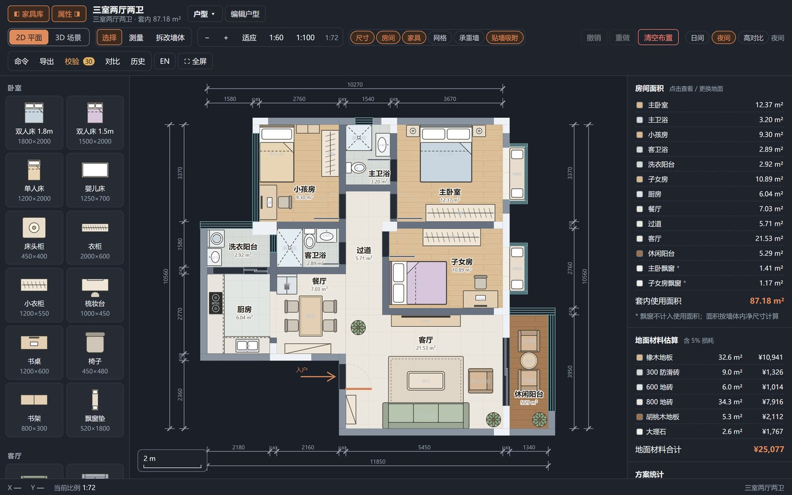

**高对比**：


### 11.2 语言


点顶栏「**EN**」切换中 / 英文。界面文案、导出文件表头、校验告警均跟随切换。

### 11.3 命令面板

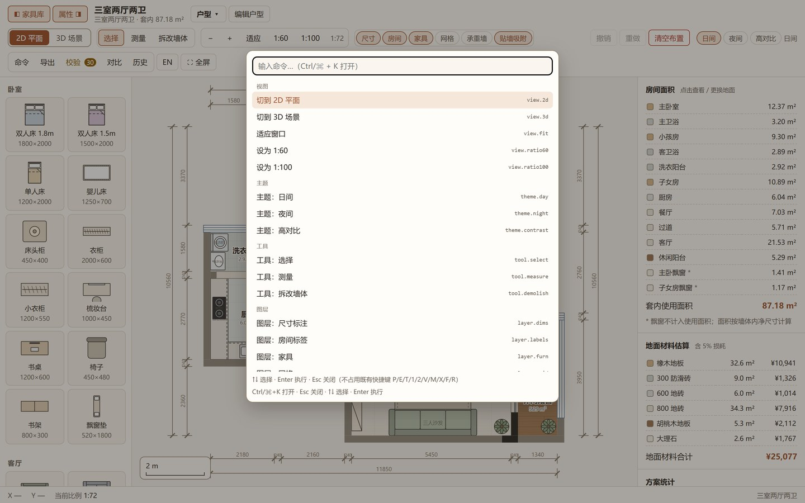

按 `Ctrl/⌘ + K` 打开命令面板，可搜索并执行全部 **30 条命令**（视图 / 主题 / 工具 / 图层 / 编辑 / 方案 / 导出 / 校验）。

### 11.4 全屏

按 `Shift + F` 或点「⛶ 全屏」。

---

## 12. 快捷键总表

### 12.1 通用

| 快捷键 | 功能 |
| --- | --- |
| `Ctrl/⌘ + K` | 打开**命令面板**（可搜索全部 30 条命令） |
| `Ctrl/⌘ + Z` | 撤销 |
| `Ctrl/⌘ + Shift + Z` / `Ctrl/⌘ + Y` | 重做 |
| `Ctrl/⌘ + D` | 复制选中的家具 |
| `Shift + F` | 全屏切换 |
| `T` | 2D / 3D 切换 |
| `Esc` | 逐级退出：绘制点 → 户型弹窗 → 测量起点 → 回到选择工具 |

### 12.2 工具

| 快捷键 | 功能 |
| --- | --- |
| `V` | 选择工具 |
| `M` | 测量工具（`Shift` 锁定水平/垂直） |
| `X` | 拆改墙体工具 |
| `E` | 进入 / 退出结构编辑（仅 2D） |
| `Enter` | 闭合绘制中的房间多边形 |

### 12.3 视图

| 快捷键 | 功能 |
| --- | --- |
| `F` | 适应窗口 |
| `+` / `=` | 放大 |
| `-` | 缩小 |
| `[` | 开合家具库 |
| `]` | 开合属性面板 |
| `P` | 打开户型库 |
| `1` / `2` | 复式切换楼层 |

### 12.4 选中对象

| 快捷键 | 功能 |
| --- | --- |
| `R` | 旋转 +90° |
| `Shift + R` | 旋转 −90° |
| `Delete` / `Backspace` | 删除选中 |
| `↑ ↓ ← →` | 微调移动 10mm |
| `Shift + ↑ ↓ ← →` | 微调移动 100mm |

### 12.5 3D 漫游

| 快捷键 | 功能 |
| --- | --- |
| `W` `A` `S` `D` | 前后左右移动 |
| `↑ ↓ ← →` | 同 WASD |
| `Shift`（按住） | 快走（1.4 → 2.6 m/s） |
| `E` | 开关正前方的门 |
| `Esc` | 退出漫游 / 暂停 |

> **快捷键失效的情况**（与设计一致）：
> - 焦点在输入框 / 下拉框 / 文本域内
> - 3D 漫游模式下，`V` `M` `X` `F` `+` `-` 被忽略

---

## 13. 触屏操作

| 操作 | 手势 |
| --- | --- |
| 平移画布 | 单指拖动（在空白处） |
| 缩放 | 双指捏合（以双指中点为锚点） |
| 移动家具 | 单指拖动家具 |
| 选中家具 | 轻点 |
| 3D 旋转 | 单指拖动 |
| 3D 漫游移动 | 左下**摇杆** |
| 3D 转向 | 在画面上拖动 |

**触屏优化**：

- 点击热区自动放大（桌面 4px → 触屏 9px）
- 按钮高度增加，适配手指
- 侧栏改为抽屉，可从边缘滑出
- 窄屏自动收起次要信息（副标题、底栏坐标）

**键盘可达**（无障碍）：

- 平面图中的家具可用 `Tab` 逐个聚焦，`Enter` 选中
- 选中后用方向键移动、`R` 旋转、`Delete` 删除
- 屏幕阅读器会念出家具名称（如「双人床」）

---

## 14. 数据与存储

### 14.1 自动保存

所有改动**自动保存**到浏览器本地存储，无需手动保存。

| 键名 | 内容 |
| --- | --- |
| `huxing-plans-v1` | 自定义户型库 + 上次打开的户型 |
| `huxing-state-v2-<户型id>` | 单层户型的家具布置 |
| `huxing-state-v2-<户型id>-l<层>` | 复式每层的布置 |
| `huxing-lang` | 语言偏好 |
| `huxing-panes` | 侧栏开合状态 |
| `huxing-theme-v1` | 主题偏好 |
| `huxing-design-v1` | 旧版兼容键（自动迁移） |

### 14.2 数据安全

- 数据只存在**当前浏览器**，不上传服务器
- 清除浏览器数据会丢失布置 → **重要方案请导出 JSON 备份**
- 隐私模式 / 存储配额满时会静默降级，并在配额超限时提示

### 14.3 备份建议

1. 顶栏「导出」→「JSON（全部方案）」定期备份
2. 需要跨设备迁移时，用该文件在另一台机器「导入户型 JSON」

---

## 15. 常见问题

**Q：2D 图上的家具拖不动？**
A：确认当前是**选择**工具（按 `V`），且点中的是家具本身而非房间。

**Q：改了房间材质，3D 里没变化？**
A：3D 会跟随变化；若没更新，按 `T` 切到 2D 再切回 3D 强制重建。

**Q：承重墙拆不掉？**
A：这是设计如此——承重墙与外墙不允许拆除，会有提示。只有非承重墙与矮墙可拆。

**Q：3D 卡顿？**
A：可在 3D 工具栏切到「剖切墙」减少渲染量；或关闭「家具」显示。低端设备建议用 2D 编辑。

**Q：导出的 PDF 是空的？**
A：当前版本用「打印 → 另存为 PDF」代替直接生成 PDF。点「打印」后，在浏览器打印对话框选「另存为 PDF」。

**Q：换电脑后数据没了？**
A：数据存在浏览器本地。请用「导出 → JSON（全部方案）」备份，再在新机器导入。

**Q：界面是英文，怎么改回中文？**
A：点顶栏「EN / 中文」按钮切换。

---

## 16. 开发者文档

想了解实现细节、契约与架构，请看：

| 文档 | 内容 |
| --- | --- |
| [`docs/SPEC.md`](docs/SPEC.md) | **施工图**：类型/store 冻结契约、主题令牌表、2D↔3D 接口、依赖清单 |
| [`docs/ORIGINAL-FEATURES.md`](docs/ORIGINAL-FEATURES.md) | 原 `装修设计.html` 的逐项功能盘点（带行号证据） |
| [`docs/MIGRATION.md`](docs/MIGRATION.md) | 原功能 → 新模块的完整对照表 |
| [`docs/OSS-RESEARCH.md`](docs/OSS-RESEARCH.md) | 开源同类项目与可复用库调研 |
| [`docs/THIRD-PARTY.md`](docs/THIRD-PARTY.md) | 第三方依赖登记（许可证、用途） |
| [`docs/ROADMAP.md`](docs/ROADMAP.md) | 后续迭代路线图、技术债 |

### 开发命令

```bash
pnpm dev            # 开发服务器 :5173
pnpm build          # 类型检查 + 生产构建
pnpm preview        # 预览构建产物 :4173
pnpm test           # 单元测试（216 项，含主题对比度与场景状态断言）
pnpm test:e2e       # E2E 测试（7 项，真实浏览器，需先 pnpm build）
pnpm test:e2e:ui    # E2E 交互式调试
pnpm typecheck      # 只做类型检查
pnpm lint           # ESLint（含模块边界规则 B1–B9）
pnpm format         # Prettier 格式化
pnpm verify         # 工程自检（20 项静态闸门，零依赖）
```

### 测试分层

项目有**三层**验证，各有明确分工：

| 层 | 命令 | 环境 | 抓什么 |
| --- | --- | --- | --- |
| **静态闸门** | `pnpm verify` | 纯 Node | 目录结构、依赖白名单、颜色令牌、hex 越界、导入可解析 |
| **单元测试** | `pnpm test` | node / jsdom | 签名计算、store 契约、主题对比度、组件接线 |
| **E2E** | `pnpm test:e2e` | 真实 Chrome | **渲染结果**：几何是否真的建出来、切换户型是否重建 |

> **为什么需要 E2E**：项目曾出现两类「所有自动化检查全绿但功能是错的」缺陷：
> ① 3D 视图打不开（`registerViewMount` 从未调用）；
> ② 复式户型 3D 里一个几何都没有（引擎用了 `plan` 而非 `plan.levelData`）。
> 这两类**装配缺陷**只有读真实场景状态才能发现。E2E 用 `window.__DSH_SCENE_STATS__`
> 断言 `archMeshes > 0`、房间标签与当前户型匹配。
>
> 这些 E2E 测试做过**变异验证**：故意重新注入上述两个缺陷，测试会立刻失败
> —— 证明它们真的能抓 bug，不是摆设。

### 验证脚本（`.tools/`，本地用，不入库）

```bash
node .tools/render-check.cjs          # 浏览器实渲染 8 项
node .tools/audit-features.cjs        # 特色功能可用性 10 项
node .tools/audit-keyboard.cjs        # 键盘可达性 5 项
node .tools/verify-switch-content.cjs # 2D/3D 切换内容完整性 4 项
node .tools/verify-3d-bidi.cjs        # 3D 双向验证 6 项
node .tools/perf-switch.cjs           # 切换性能测量
```

> 这些脚本用本机 Chrome 跑真实浏览器验证。**它们能发现自动化检查抓不到的问题**
> ——例如「组件写了但没挂载」这类缺陷，`typecheck`/单测/lint 全部通过但功能不可达。

### 目录结构

```
decoration-studio/
├─ src/
│  ├─ main.ts  App.vue    入口与应用外壳
│  ├─ types/              纯类型定义
│  ├─ theme/              主题令牌（唯一色值来源）
│  ├─ stores/             Pinia 状态（plan/layout/ui/theme/toast）
│  ├─ utils/              几何/测量/持久化工具
│  ├─ composables/        指针交互/快捷键/焦点陷阱等
│  ├─ data/               家具库(60)/材料表(8)/内置户型(7)
│  ├─ components/         工具栏/面板/弹窗
│  └─ features/
│     ├─ plan2d/          2D 平面编辑器（11 图层）
│     ├─ scene3d/         3D 场景（three.js）
│     └─ extras/          亮点层（报价/对比/校验/导出/命令面板）
├─ docs/                  设计文档
├─ scripts/verify.mjs     工程自检
└─ tools/publish.ps1      发布脚本
```

### 环境要求

- Node `^20.19.0 || >=22.12.0`
- pnpm（`corepack enable` 可启用）
- 浏览器验证脚本需要本机 Chrome

### 许可证

MIT（见 `LICENSE`）。依赖许可证一律 MIT / ISC / Apache-2.0 / BSD / Zlib / CC0；
GPL / AGPL 与无 license 的项目只读思路、零代码拷贝。

### 附录：命令跑不起来时（`pwsh` / `node` 启动失败）

本项目开发过程中遇到过一种**环境级故障**，记录下来供排查：

**症状**：任何命令都返回 `exit code 3221225794`（`0xC0000142` = `STATUS_DLL_INIT_FAILED`），
连 `echo hi`、`node -v`、绝对路径 `node.exe` 都无输出。这不是命令写错，而是**进程创建失败**。

**排查顺序**：

1. 先试最简命令（`echo hi`）——若也失败，就是环境问题，不要再怀疑命令语法。
2. 若处于沙箱/受限模式下，确认文件系统策略是否允许执行。
3. 重启 DSH / 终端宿主进程。该故障是 OS 级的，与项目代码无关。

**故障期间的替代方式**：改用 DSH 自带 runtime 的**绝对路径**调用，不依赖 `PATH`：

```text
node:  C:\Users\Admin\.dsh\dsh-runtimes\dsh-primary-runtime\dependencies\node\bin\node.exe
pnpm:  C:\Users\Admin\.dsh\dsh-runtimes\dsh-primary-runtime\dependencies\pnpm\bin\pnpm.mjs
```

**纪律**：若命令确实无法执行，在报告里明确写「**未验证**」并附应执行的命令原文，
⛔ 不得伪造输出，也不得以「看起来通过」代替证据。
